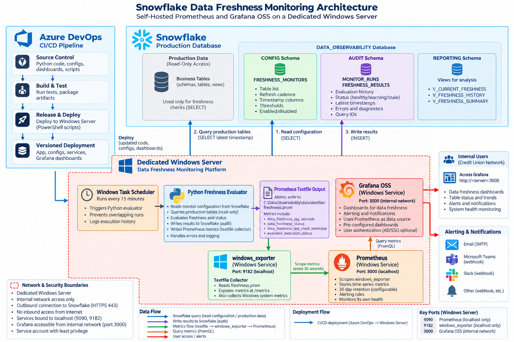

# Monitoring architecture

The supplied diagram shows Azure DevOps delivery to a dedicated Windows Server,
Snowflake configuration and audit schemas, scheduled Python evaluation, and the
textfile → windows_exporter → Prometheus → Grafana metrics flow. Production
Snowflake access is read-only; audit writes target DATA_OBSERVABILITY.

## Implementation notes

- Prometheus listens on **127.0.0.1:9090**. Its box in the diagram incorrectly
  labels port 3000; the diagram's key ports legend lists the correct port.
  Grafana uses port 3000 and initially binds to loopback; internal access requires
  explicit configuration as described in the [deployment guide](../deployment.md).
- The textfile box abbreviates metric names. The implementation exports
  `data_freshness_last_check_timestamp_seconds`,
  `data_freshness_evaluation_success`, and
  `data_freshness_evaluator_last_success_timestamp_seconds`; see the
  [README metrics section](../../README.md#metrics-and-dashboards) for semantics.
- Audit persistence uses idempotent MERGE statements (INSERT/UPDATE), rather
  than only INSERT as shown on the results arrow. The evaluator also records
  ERROR status, and reporting views mark missing evaluations as MISSING.
- Notification channels and optional AD/SSO shown in the diagram require operator
  configuration. They are not automatically connected by this repository.

The uploaded PNG is preserved as supplied and included in source distributions.
